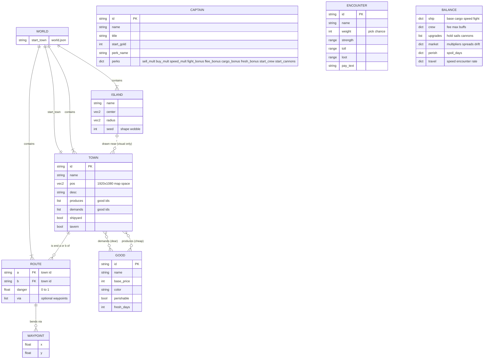
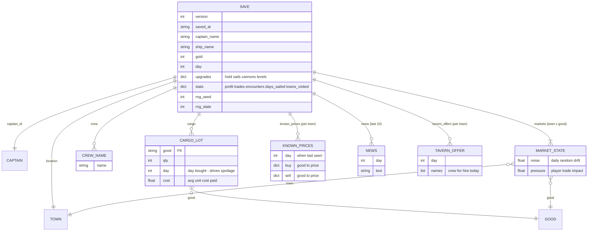
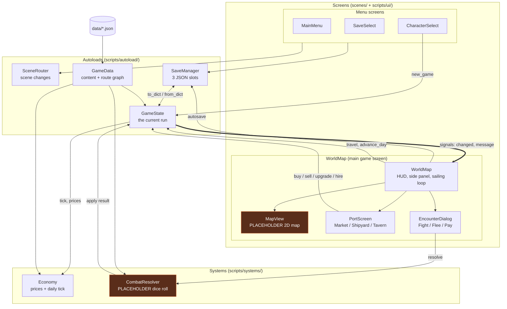
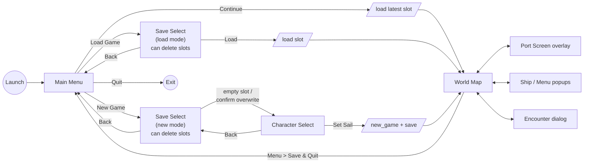
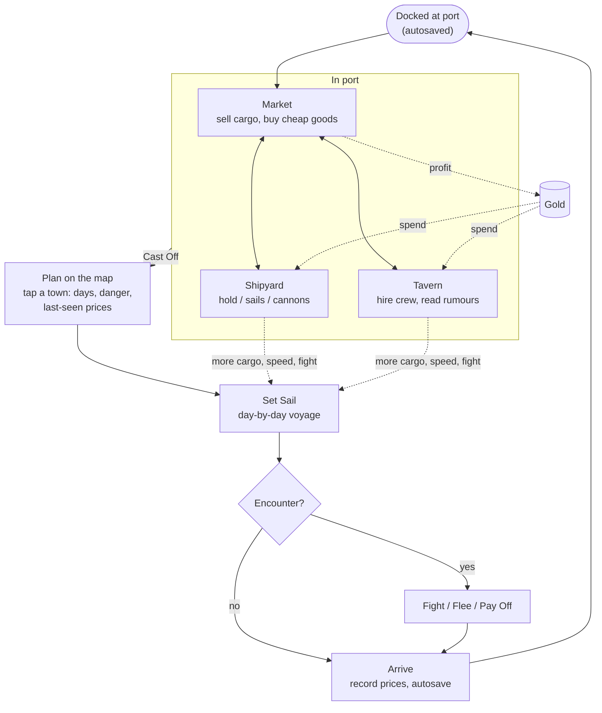
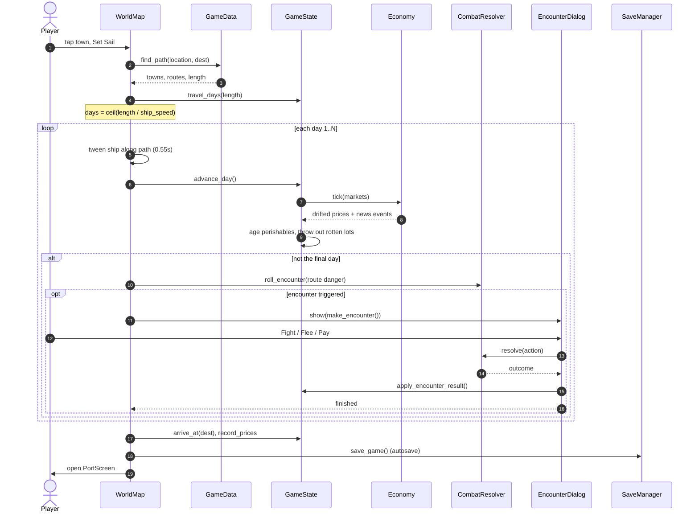
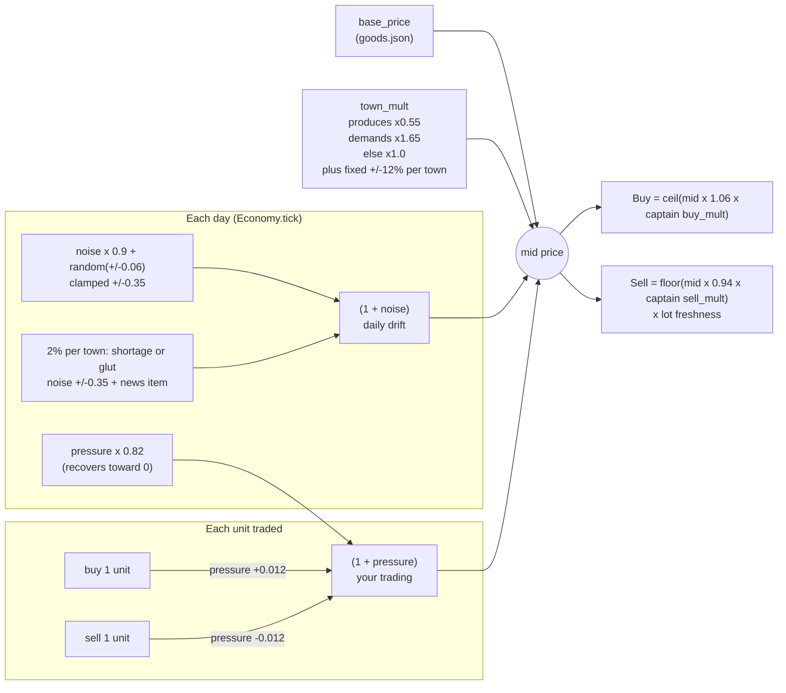
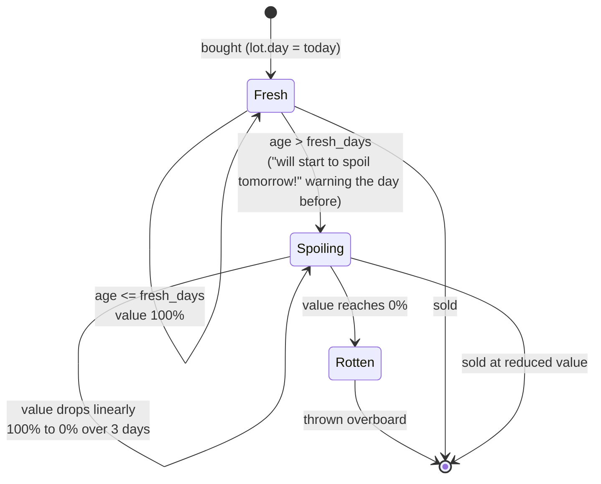
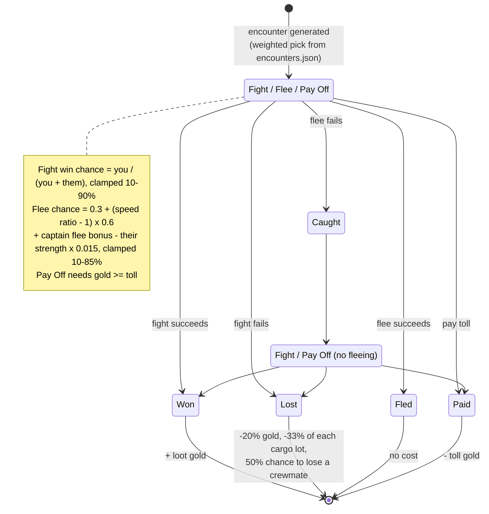

# AshCove — Diagrams (prototype v0.1)

Mermaid diagrams of the prototype's data, systems and gameplay loop. GitHub renders these inline; in VS Code use a Mermaid preview extension.

Numbers quoted below are the defaults in `ash-cove/data/balance.json`. If you change the code or data, update these diagrams too.

- [1. Data](#1-data)
  - [1.1 Static game data (JSON)](#11-static-game-data-json)
  - [1.2 Save file (the current run)](#12-save-file-the-current-run)
- [2. Systems](#2-systems)
  - [2.1 Architecture](#21-architecture)
  - [2.2 Screen flow](#22-screen-flow)
- [3. Gameplay](#3-gameplay)
  - [3.1 Core loop](#31-core-loop)
  - [3.2 A voyage, day by day](#32-a-voyage-day-by-day)
  - [3.3 Market price model](#33-market-price-model)
  - [3.4 Perishable goods](#34-perishable-goods)
  - [3.5 Encounters (placeholder combat)](#35-encounters-placeholder-combat)

---

## 1. Data

### 1.1 Static game data (JSON)

Read-only content loaded by `GameData` from `ash-cove/data/`. Editing these files changes the world without code changes.

### 1.2 Save file (the current run)

`GameState.to_dict()` is written by `SaveManager` to `user://saves/slot_N.json` (N = 0–2). On Windows that's `%APPDATA%/Godot/app_userdata/AshCove/saves/`.

---

## 2. Systems

### 2.1 Architecture

Autoloads hold all state and rules. Screens are thin `.tscn` roots that build their UI in code and talk to the autoloads. The **placeholder** parts (the map renderer and combat) are kept separate so they can be swapped out.

Not drawn, to keep the graph readable: every screen uses the `UI` autoload for its theme and widgets, and `MapView` reads `GameData` and `GameState` directly to draw the map.

**Swap points:**
- **2.5D map** — replace `MapView` with anything that emits `town_clicked(id)` and has `ship_pos`, `ship_heading`, `selected_town` and `highlight_path` properties.
- **Real combat** — replace `CombatResolver.resolve_fight()`, or have `EncounterDialog` open a combat scene and pass its result to `CombatResolver.fight_outcome(enc, won, rng)`.

### 2.2 Screen flow

---

## 3. Gameplay

### 3.1 Core loop

### 3.2 A voyage, day by day

What `WorldMap._set_sail()` does from the moment you press **Set Sail**.

### 3.3 Market price model

Every town keeps a `noise` and a `pressure` value for every good.

### 3.4 Perishable goods

Each cargo lot remembers the day it was bought. Defaults: Fish 3 days fresh, Sunfruit 4, Elixir 6, plus 2 for the Quartermaster. Selling takes from the oldest lot first.

### 3.5 Encounters (placeholder combat)

The encounter chance is rolled on every day at sea except the arrival day: `0.12 x (0.5 + route danger)`. Enemy strength, toll and loot scale by `1 + day/60`.

Your fight strength = 2 base + 2 per Cannons level + 0.5 per crewmate + captain bonus (Privateer +3).
